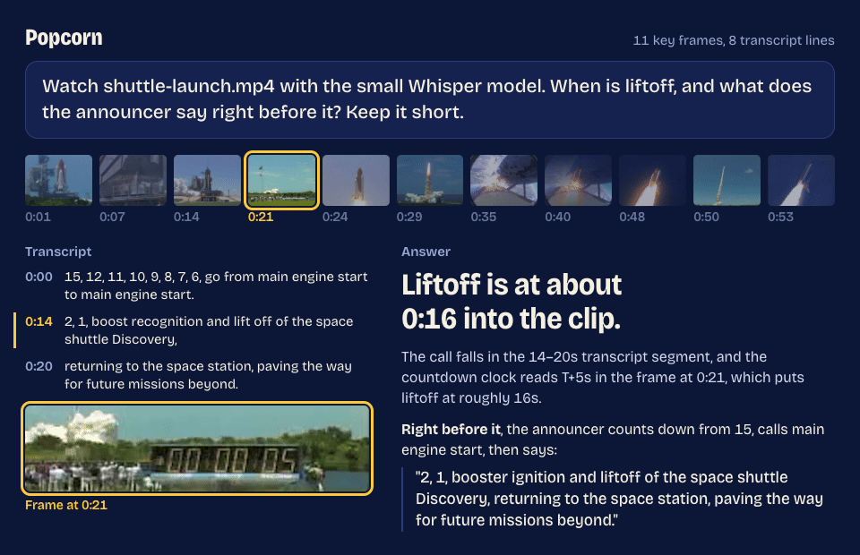

<div dir="rtl">

<h1 align="center">
  <br>
  🍿
  <br>
  popcorn
  <br>
</h1>

يتيح Popcorn لـ Claude Code ولغيره من وكلاء MCP مشاهدة ملف فيديو على جهازك.



يعيد Popcorn الإطارات الرئيسية عند تغير المشاهد، مع نص مفرغ بطوابع زمنية.

**التثبيت في Claude Code**

<div dir="ltr">

```bash
claude mcp add popcorn -- npx -y claude-popcorn
```

</div>

**أو ثبّته كإضافة في Claude Code.** تضيف هذه الطريقة أيضا مهارة &lrm;`/popcorn:watch`. نفّذ هذين الأمرين داخل Claude Code:

<div dir="ltr">

```
/plugin marketplace add haithamelmengad/claude-popcorn
/plugin install popcorn@popcorn
```

</div>

**جرّبه**

اطلب بكلمات بسيطة واكتب المسار الكامل للفيديو:

- `Watch /path/to/talk.mp4 and tell me what it is about.`&lrm;
- `In /path/to/talk.mp4, where do they talk about pricing? Give me the time.`&lrm;
- `Give me the transcript of /path/to/talk.mp4 from 0:20 to 0:30.`&lrm;

**يعمل مع**

| العميل | الإعداد |
|--------|---------|
| Claude Code | الأمر أو الإضافة أعلاه |
| Claude Desktop | أضف الخادم إلى `claude_desktop_config.json`. راجع [البدء السريع](#البدء-السريع) |
| Codex | `codex mcp add popcorn -- npx -y claude-popcorn` |
| Cursor | أضف مدخل `mcpServers` نفسه إلى &lrm;`~/.cursor/mcp.json` |

**المتطلبات**

- توفر [FFmpeg](https://ffmpeg.org/) في PATH
- الإصدار 20 أو أحدث من Node.js
- محرك Whisper واحد للتفريغ النصي. من دونه ستحصل على الإطارات على أي حال. راجع [محركات التفريغ النصي](#محركات-التفريغ-النصي)

<p align="center">
  <a href="../../README.md">🇺🇸 English</a> •
  <a href="README.zh.md">🇨🇳 中文</a> •
  <a href="README.ja.md">🇯🇵 日本語</a> •
  <a href="README.ko.md">🇰🇷 한국어</a> •
  <a href="README.es.md">🇪🇸 Español</a> •
  <a href="README.de.md">🇩🇪 Deutsch</a> •
  <a href="README.fr.md">🇫🇷 Français</a> •
  <a href="README.pt.md">🇧🇷 Português</a> •
  <a href="README.ru.md">🇷🇺 Русский</a> •
  <a href="README.ar.md">🇸🇦 العربية</a> •
  <a href="README.it.md">🇮🇹 Italiano</a> •
  <a href="README.nl.md">🇳🇱 Nederlands</a> •
  <a href="README.tr.md">🇹🇷 Türkçe</a> •
  <a href="README.vi.md">🇻🇳 Tiếng Việt</a> •
  <a href="README.hi.md">🇮🇳 हिन्दी</a>
</p>

<p align="center">
  <a href="#البدء-السريع">البدء السريع</a> •
  <a href="#كيف-يعمل">كيف يعمل</a> •
  <a href="#أدوات-mcp">أدوات MCP</a> •
  <a href="#محركات-التفريغ-النصي">التفريغ النصي</a> •
  <a href="#الإعدادات">الإعدادات</a> •
  <a href="#حل-المشكلات">حل المشكلات</a> •
  <a href="#الترخيص">الترخيص</a>
</p>

---

## البدء السريع

<div dir="ltr">

```bash
# Install FFmpeg (required)
brew install ffmpeg                    # macOS
sudo apt install ffmpeg                # Ubuntu/Debian

# Optional: Install a transcription backend
pip install mlx-whisper                # Apple Silicon (fastest)
pip install openai-whisper             # Any platform

# Add Popcorn to Claude Code
claude mcp add popcorn -- npx -y claude-popcorn
```

</div>

لاستخدامه مع Claude Desktop، أضف ما يلي إلى الملف &lrm;`~/Library/Application Support/Claude/claude_desktop_config.json`:

<div dir="ltr">

```json
{
  "mcpServers": {
    "popcorn": {
      "command": "npx",
      "args": ["-y", "claude-popcorn"]
    }
  }
}
```

</div>

**أهم المزايا:**

- **اكتشاف المشاهد**: يلتقط الإطارات عند الانتقالات البصرية، لا على فترات ثابتة
- **تفريغ نصي محلي**: 4 محركات متاحة (mlx-whisper, faster-whisper, whisper-cpp, whisper)
- **صور مضمنة**: يعيد الإطارات الرئيسية مباشرة ضمن ردود MCP
- **إعدادات مسبقة ذكية**: ضبط تلقائي لتسجيلات الشاشة والعروض التقديمية والأفلام والمقابلات
- **بلا إعداد**: مرّر مسار الفيديو فقط وسيعمل
- **الخصوصية أولا**: كل شيء يعمل محليا، ولا تغادر أي بيانات جهازك. تنزَّل نماذج Whisper مرة واحدة عند أول استخدام

---

## التوثيق

### بداية الاستخدام

- **[البدء السريع](#البدء-السريع)**: التثبيت والإعداد
- **[الدليل التعليمي](../tutorial.md)**: شرح الاستخدام خطوة بخطوة
- **[أدوات MCP](#أدوات-mcp)**: مرجع الأدوات المتاحة

### الأدلة

- **[محركات التفريغ النصي](#محركات-التفريغ-النصي)**: اختر أفضل محرك لنظامك
- **[أنواع الفيديو والأهداف](#أنواع-الفيديو)**: إعدادات مسبقة لأنواع المحتوى المختلفة
- **[الإعدادات](#الإعدادات)**: معاملات متقدمة

### المراجع

- **[حل المشكلات](../troubleshooting.md)**: المشكلات الشائعة وحلولها
- **[مهارة الوكيل](../../skills/watch/SKILL.md)**: تعليمات لوكلاء الذكاء الاصطناعي
- **[مرجع API](#أدوات-mcp)**: مخططات الأدوات والردود

---

## كيف يعمل

**المكونات الأساسية:**

1. **أداة FFprobe**: تستخرج البيانات الوصفية للفيديو (المدة، الدقة، برامج الترميز)
2. **اكتشاف المشاهد في FFmpeg**: يجد الانتقالات البصرية باستخدام المرشح `select='gt(scene,N)'`&lrm;
3. **استخراج الإطارات بالتوازي**: يحفظ صور JPEG عند أوقات تغير المشاهد
4. **تفريغ نصي متعدد المحركات**: تحوّل نسخ Whisper المختلفة الصوت إلى نص بطوابع زمنية
5. **حزمة التحليل**: تحفظ النتائج في المجلد &lrm;`.popcorn/`&lrm;
6. **رد MCP**: يعيد البيانات الوصفية مع صور base64 مضمنة

<div dir="ltr">

```
Video File ──▶ FFprobe ──▶ FFmpeg ──▶ Whisper ──▶ Analysis Bundle
                 │           │          │              │
                 ▼           ▼          ▼              ▼
              metadata    frames    transcript    MCP Response
```

</div>

---

## أدوات MCP

| الأداة | الوصف |
|--------|-------|
| `popcorn_analyze` | التحليل الرئيسي: يستخرج الإطارات، يفرّغ الصوت نصيا، ويعيد النتائج |
| `popcorn_suggest` | يفحص البيانات الوصفية للفيديو ويقترح الإعدادات المناسبة |
| `popcorn_presets` | يعرض أنواع الفيديو والأهداف المتاحة |
| `popcorn_backends` | يكتشف نظامك ويعرض خيارات التفريغ النصي |
| `popcorn_read` | يقرأ مقاطع من النص المفرغ مع التصفية حسب الوقت |

### الاستخدام الأساسي

<div dir="ltr">

```json
{
  "tool": "popcorn_analyze",
  "arguments": {
    "path": "/path/to/video.mp4"
  }
}
```

</div>

### مع الإعدادات المسبقة

<div dir="ltr">

```json
{
  "tool": "popcorn_analyze",
  "arguments": {
    "path": "/path/to/video.mp4",
    "videoType": "screencast",
    "objective": "detailed"
  }
}
```

</div>

---

## أنواع الفيديو

| النوع | الأنسب لـ | اكتشاف المشاهد |
|-------|-----------|----------------|
| `screencast` | الدروس التعليمية، جلسات البرمجة، عروض الواجهات | عتبة منخفضة |
| `presentation` | الشرائح، المحاضرات، الكلمات الرئيسية | انتقالات الشرائح |
| `movie` | الأفلام، المسلسلات التلفزيونية | متوازن |
| `interview` | البودكاست، مقاطع المتحدث أمام الكاميرا | أولوية للتفريغ النصي |
| `surveillance` | تسجيلات المراقبة، كاميرات السيارات | عتبة مرتفعة |
| `sports` | الأحداث المباشرة، الحركة السريعة | معدل إطارات مرتفع |

## الأهداف

| الهدف | متى تستخدمه |
|-------|-------------|
| `summary` | تحتاج إلى نظرة عامة سريعة |
| `detailed` | لا تريد أن يفوتك شيء |
| `find_moment` | تبحث عن محتوى محدد |
| `transcribe` | الصوت والكلام هما الأهم |
| `visual_only` | تهمك الصورة فقط |
| `quick_scan` | تحتاج إلى معاينة سريعة |

---

## محركات التفريغ النصي

يكتشف Popcorn نظامك تلقائيا ويقترح أفضل محرك.

### مقارنة المحركات

| المحرك | السرعة | الأنسب لـ | التثبيت |
|--------|--------|-----------|---------|
| **mlx-whisper** | الأسرع | Apple Silicon (M1/M2/M3/M4) | `pip install mlx-whisper` |
| **faster-whisper** | سريع | بطاقات NVIDIA الرسومية | `pip install faster-whisper` |
| **whisper-cpp** | متوسط | مختلف المنصات | `brew install whisper-cpp` |
| **whisper** | بطيء | الأكثر توافقا | `pip install openai-whisper` |

يحتاج whisper-cpp إلى ملف نموذج. نزّل نموذج ggml من [whisper.cpp](https://github.com/ggml-org/whisper.cpp/tree/master/models) واضبط متغير البيئة `WHISPER_CPP_MODEL` على مساره، أو مرّر المسار في المعامل `model`. من دون ملف نموذج، يبلغ Popcorn بأن هذا المحرك غير متاح.

### أزمنة المعالجة (فيديو مدته 60 دقيقة)

| المحرك | الوقت |
|--------|-------|
| mlx-whisper | 3-8 دقائق |
| faster-whisper | 5-10 دقائق |
| whisper-cpp | 10-20 دقيقة |
| whisper | 30-60 دقيقة |

### فرض محرك معين

<div dir="ltr">

```json
{
  "tool": "popcorn_analyze",
  "arguments": {
    "path": "/path/to/video.mp4",
    "backend": "mlx-whisper"
  }
}
```

</div>

---

## الإعدادات

### جميع المعاملات

| المعامل | النوع | الوصف |
|---------|-------|-------|
| `path` | string | **مطلوب.** المسار المطلق لملف الفيديو |
| `videoType` | string | الإعداد المسبق لنوع الفيديو |
| `objective` | string | الإعداد المسبق لهدف التحليل |
| `transcribe` | boolean | تفعيل التفريغ النصي أو تعطيله |
| `backend` | string | محرك التفريغ النصي |
| `model` | string | نموذج Whisper (`tiny`, `base`, `small`, `medium`, `large`). مع whisper-cpp: مسار ملف نموذج ggml |
| `language` | string | رمز اللغة (مثل `en` و`es` و`fr`) |
| `frameMode` | string | `scene` أو `interval` |
| `framesPerMin` | number | عدد الإطارات في الدقيقة في وضع `interval` |
| `sceneThreshold` | number | حساسية اكتشاف المشاهد (0-1) |
| `minSceneInterval` | number | أقل عدد من الثواني بين إطارات المشاهد |
| `maxFrames` | number | أقصى عدد من الإطارات المستخرجة |
| `inlineFrames` | number | عدد الإطارات المعادة بصيغة base64 |
| `maxChunkChars` | number | حجم مقطع النص المفرغ بالأحرف |
| `maxTranscriptChars` | number | طول مقتطف النص المفرغ في الرد |
| `outDir` | string | مجلد إخراج حزمة التحليل |

### بنية المخرجات

<div dir="ltr">

```
.popcorn/<video>_<timestamp>/
├── analysis.json          # Full metadata
├── transcript.txt         # Plain text
├── transcript.json        # Timestamped segments
├── transcript.chunks.json # LLM-friendly chunks
└── assets/
    ├── audio.wav
    └── frames/
        ├── scene_000001.jpg
        └── ...
```

</div>

---

## حل المشكلات

### تعذر العثور على FFmpeg

<div dir="ltr">

```bash
brew install ffmpeg          # macOS
sudo apt install ffmpeg      # Ubuntu/Debian
```

</div>

### لا يوجد محرك تفريغ نصي

<div dir="ltr">

```bash
pip install mlx-whisper      # Apple Silicon
pip install openai-whisper   # Any platform
```

</div>

### عدد الإطارات المكتشفة قليل جدا

<div dir="ltr">

```json
{ "sceneThreshold": 0.15, "minSceneInterval": 2 }
```

</div>

### عدد الإطارات المكتشفة كبير جدا

<div dir="ltr">

```json
{ "sceneThreshold": 0.5, "minSceneInterval": 10 }
```

</div>

لمزيد من الحلول، راجع **[دليل حل المشكلات](../troubleshooting.md)**.

---

## التطوير

<div dir="ltr">

```bash
git clone https://github.com/haithamelmengad/claude-popcorn.git
cd claude-popcorn
npm install          # Install dependencies
npm run build        # Build
npm test             # Smoke test (needs ffmpeg)
npm run dev          # Development mode
npm start            # Run server
```

</div>

### بنية المشروع

<div dir="ltr">

```
claude-popcorn/
├── src/
│   ├── index.ts        # MCP server
│   ├── analyze.ts      # Analysis pipeline
│   ├── ffmpeg.ts       # Video processing
│   ├── transcribe.ts   # Multi-backend transcription
│   ├── presets.ts      # Video type presets
│   ├── read.ts         # File and transcript reading
│   └── commands.ts     # Shell execution
├── docs/               # Documentation
└── skills/             # Agent skills
```

</div>

---

## المساهمة

1. أنشئ نسخة (fork) من المستودع
2. أنشئ فرعا للميزة (`git checkout -b feature/amazing`)
3. احفظ تغييراتك في commit (`git commit -m 'Add amazing feature'`&lrm;)
4. ادفع الفرع (`git push origin feature/amazing`)
5. افتح Pull Request

---

## الترخيص

ترخيص MIT. راجع ملف [LICENSE](../../LICENSE) لمعرفة التفاصيل.

---

## شكر وتقدير

- [OpenAI Whisper](https://github.com/openai/whisper): التعرف على الكلام
- [whisper.cpp](https://github.com/ggerganov/whisper.cpp): نسخة بلغة C++&lrm;
- [MLX Whisper](https://github.com/ml-explore/mlx-examples): Apple Silicon
- [faster-whisper](https://github.com/guillaumekln/faster-whisper): CTranslate2
- [FFmpeg](https://ffmpeg.org/): معالجة الفيديو
- [Model Context Protocol](https://modelcontextprotocol.io/): مواصفة MCP

---

يعد Popcorn مشروعا مستقلا. لا يرتبط بشركة Anthropic ولا يحظى بتأييدها.

<p align="center">
  مصنوع مع 🍿 لوكلاء الذكاء الاصطناعي في كل مكان
</p>

</div>
