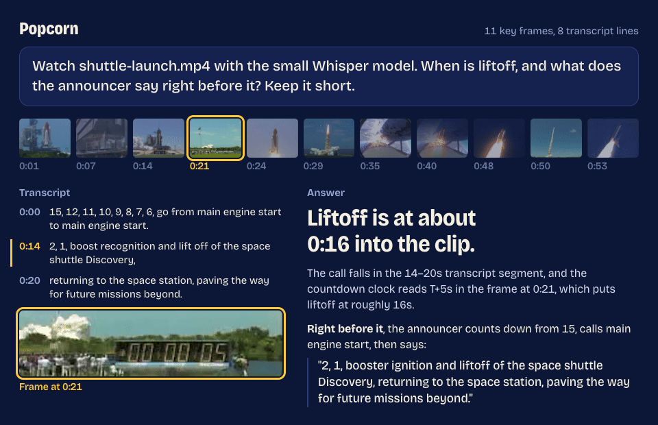

<h1 align="center">
  <br>
  🍿
  <br>
  popcorn
  <br>
</h1>

Popcorn की मदद से Claude Code और दूसरे MCP एजेंट आपकी मशीन पर रखी वीडियो फ़ाइल देख सकते हैं।



यह सीन बदलने की जगहों के मुख्य फ़्रेम और टाइमस्टैम्प वाली ट्रांसक्रिप्ट लौटाता है।

**Claude Code के लिए इंस्टॉल करें**

```bash
claude mcp add popcorn -- npx -y claude-popcorn
```

**या इसे Claude Code प्लगइन के रूप में इंस्टॉल करें।** इससे `/popcorn:watch` स्किल भी जुड़ जाती है। ये कमांड Claude Code के अंदर चलाएँ:

```
/plugin marketplace add haithamelmengad/claude-popcorn
/plugin install popcorn@popcorn
```

**आज़माकर देखें**

सीधे शब्दों में पूछें और वीडियो का पूरा पाथ दें:

- `Watch /path/to/talk.mp4 and tell me what it is about.`
- `In /path/to/talk.mp4, where do they talk about pricing? Give me the time.`
- `Give me the transcript of /path/to/talk.mp4 from 0:20 to 0:30.`

**इनके साथ काम करता है**

| क्लाइंट | सेटअप |
|--------|-------|
| Claude Code | ऊपर दी गई कमांड या प्लगइन |
| Claude Desktop | सर्वर को `claude_desktop_config.json` में जोड़ें। [त्वरित शुरुआत](#त्वरित-शुरुआत) देखें |
| Codex | `codex mcp add popcorn -- npx -y claude-popcorn` |
| Cursor | वही `mcpServers` एंट्री `~/.cursor/mcp.json` में जोड़ें |

**ज़रूरतें**

- आपके PATH में [FFmpeg](https://ffmpeg.org/)
- Node.js 20 या उससे नया
- ट्रांसक्रिप्ट के लिए एक Whisper बैकएंड। इसके बिना भी फ़्रेम मिलते हैं। [ट्रांसक्रिप्शन बैकएंड](#ट्रांसक्रिप्शन-बैकएंड) देखें

<p align="center">
  <a href="../../README.md">🇺🇸 English</a> •
  <a href="README.zh.md">🇨🇳 中文</a> •
  <a href="README.ja.md">🇯🇵 日本語</a> •
  <a href="README.ko.md">🇰🇷 한국어</a> •
  <a href="README.es.md">🇪🇸 Español</a> •
  <a href="README.de.md">🇩🇪 Deutsch</a> •
  <a href="README.fr.md">🇫🇷 Français</a> •
  <a href="README.pt.md">🇧🇷 Português</a> •
  <a href="README.ru.md">🇷🇺 Русский</a> •
  <a href="README.ar.md">🇸🇦 العربية</a> •
  <a href="README.it.md">🇮🇹 Italiano</a> •
  <a href="README.nl.md">🇳🇱 Nederlands</a> •
  <a href="README.tr.md">🇹🇷 Türkçe</a> •
  <a href="README.vi.md">🇻🇳 Tiếng Việt</a> •
  <a href="README.hi.md">🇮🇳 हिन्दी</a>
</p>

<p align="center">
  <a href="#त्वरित-शुरुआत">त्वरित शुरुआत</a> •
  <a href="#यह-कैसे-काम-करता-है">यह कैसे काम करता है</a> •
  <a href="#mcp-टूल">MCP टूल</a> •
  <a href="#ट्रांसक्रिप्शन-बैकएंड">ट्रांसक्रिप्शन</a> •
  <a href="#कॉन्फ़िगरेशन">कॉन्फ़िगरेशन</a> •
  <a href="#समस्या-निवारण">समस्या निवारण</a> •
  <a href="#लाइसेंस">लाइसेंस</a>
</p>

---

## त्वरित शुरुआत

```bash
# Install FFmpeg (required)
brew install ffmpeg                    # macOS
sudo apt install ffmpeg                # Ubuntu/Debian

# Optional: Install a transcription backend
pip install mlx-whisper                # Apple Silicon (fastest)
pip install openai-whisper             # Any platform

# Add Popcorn to Claude Code
claude mcp add popcorn -- npx -y claude-popcorn
```

Claude Desktop के लिए, इसे `~/Library/Application Support/Claude/claude_desktop_config.json` में जोड़ें:

```json
{
  "mcpServers": {
    "popcorn": {
      "command": "npx",
      "args": ["-y", "claude-popcorn"]
    }
  }
}
```

**मुख्य सुविधाएँ:**

- **सीन डिटेक्शन**: तय अंतराल पर नहीं, बल्कि दृश्य बदलने पर फ़्रेम लेता है
- **लोकल ट्रांसक्रिप्शन**: 4 बैकएंड विकल्प (mlx-whisper, faster-whisper, whisper-cpp, whisper)
- **इनलाइन इमेज**: मुख्य फ़्रेम सीधे MCP रिस्पॉन्स में लौटाता है
- **स्मार्ट प्रीसेट**: स्क्रीनकास्ट, प्रेज़ेंटेशन, फ़िल्म और इंटरव्यू के लिए अपने आप कॉन्फ़िगर होता है
- **कोई कॉन्फ़िगरेशन नहीं**: बस वीडियो का पाथ दें और यह चल जाता है
- **प्राइवेसी पहले**: सब कुछ लोकल चलता है, कोई डेटा आपकी मशीन से बाहर नहीं जाता। Whisper मॉडल सिर्फ़ एक बार, पहली बार इस्तेमाल करने पर डाउनलोड होते हैं

---

## दस्तावेज़

### शुरुआत करें

- **[त्वरित शुरुआत](#त्वरित-शुरुआत)**: इंस्टॉलेशन और सेटअप
- **[ट्यूटोरियल](../tutorial.md)**: इस्तेमाल की चरण-दर-चरण गाइड
- **[MCP टूल](#mcp-टूल)**: उपलब्ध टूल का संदर्भ

### गाइड

- **[ट्रांसक्रिप्शन बैकएंड](#ट्रांसक्रिप्शन-बैकएंड)**: अपने सिस्टम के लिए सबसे अच्छा बैकएंड चुनें
- **[वीडियो के प्रकार और उद्देश्य](#वीडियो-के-प्रकार)**: अलग-अलग कंटेंट के लिए प्रीसेट
- **[कॉन्फ़िगरेशन](#कॉन्फ़िगरेशन)**: एडवांस पैरामीटर

### संदर्भ

- **[समस्या निवारण](../troubleshooting.md)**: आम समस्याएँ और उनके समाधान
- **[एजेंट स्किल](../../skills/watch/SKILL.md)**: AI एजेंट के लिए निर्देश
- **[API संदर्भ](#mcp-टूल)**: टूल के स्कीमा और रिस्पॉन्स

---

## यह कैसे काम करता है

**मुख्य हिस्से:**

1. **FFprobe**: वीडियो का मेटाडेटा निकालता है (अवधि, रिज़ॉल्यूशन, कोडेक)
2. **FFmpeg सीन डिटेक्शन**: `select='gt(scene,N)'` फ़िल्टर से दृश्य के बदलाव ढूँढता है
3. **पैरेलल फ़्रेम एक्सट्रैक्शन**: सीन बदलने के टाइमस्टैम्प पर JPEG लेता है
4. **मल्टी-बैकएंड ट्रांसक्रिप्शन**: Whisper के अलग-अलग रूप ऑडियो को टाइमस्टैम्प वाले टेक्स्ट में बदलते हैं
5. **एनालिसिस बंडल**: नतीजे `.popcorn/` डायरेक्टरी में सेव होते हैं
6. **MCP रिस्पॉन्स**: मेटाडेटा और इनलाइन base64 इमेज लौटाता है

```
Video File ──▶ FFprobe ──▶ FFmpeg ──▶ Whisper ──▶ Analysis Bundle
                 │           │          │              │
                 ▼           ▼          ▼              ▼
              metadata    frames    transcript    MCP Response
```

---

## MCP टूल

| टूल | विवरण |
|------|-------------|
| `popcorn_analyze` | मुख्य एनालिसिस: फ़्रेम निकालता है, ऑडियो ट्रांसक्राइब करता है और नतीजे लौटाता है |
| `popcorn_suggest` | वीडियो का मेटाडेटा जाँचता है और सुझाई गई सेटिंग देता है |
| `popcorn_presets` | उपलब्ध वीडियो प्रकार और उद्देश्य की सूची देता है |
| `popcorn_backends` | आपके सिस्टम को पहचानता है और ट्रांसक्रिप्शन के विकल्प दिखाता है |
| `popcorn_read` | समय के फ़िल्टर के साथ ट्रांसक्रिप्ट के हिस्से पढ़ता है |

### बुनियादी इस्तेमाल

```json
{
  "tool": "popcorn_analyze",
  "arguments": {
    "path": "/path/to/video.mp4"
  }
}
```

### प्रीसेट के साथ

```json
{
  "tool": "popcorn_analyze",
  "arguments": {
    "path": "/path/to/video.mp4",
    "videoType": "screencast",
    "objective": "detailed"
  }
}
```

---

## वीडियो के प्रकार

| प्रकार | किसके लिए सबसे अच्छा | सीन डिटेक्शन |
|------|----------|-----------------|
| `screencast` | ट्यूटोरियल, कोडिंग सेशन, UI डेमो | कम थ्रेशोल्ड |
| `presentation` | स्लाइड, लेक्चर, कीनोट | स्लाइड का बदलना |
| `movie` | फ़िल्में, टीवी शो | संतुलित |
| `interview` | पॉडकास्ट, कैमरे के सामने बातचीत | ट्रांसक्रिप्शन को प्राथमिकता |
| `surveillance` | सिक्योरिटी फ़ुटेज, डैशकैम | ज़्यादा थ्रेशोल्ड |
| `sports` | लाइव इवेंट, तेज़ ऐक्शन | ज़्यादा फ़्रेम रेट |

## उद्देश्य

| उद्देश्य | कब इस्तेमाल करें |
|-----------|----------|
| `summary` | जल्दी से सार चाहिए |
| `detailed` | कुछ भी छूटना नहीं चाहिए |
| `find_moment` | कोई खास हिस्सा ढूँढना है |
| `transcribe` | ऑडियो और बोली सबसे ज़रूरी है |
| `visual_only` | सिर्फ़ दृश्य से मतलब है |
| `quick_scan` | झटपट प्रीव्यू चाहिए |

---

## ट्रांसक्रिप्शन बैकएंड

Popcorn आपके सिस्टम को अपने आप पहचानता है और सबसे अच्छा बैकएंड सुझाता है।

### बैकएंड की तुलना

| बैकएंड | गति | किसके लिए सबसे अच्छा | इंस्टॉल |
|---------|-------|----------|---------|
| **mlx-whisper** | सबसे तेज़ | Apple Silicon (M1/M2/M3/M4) | `pip install mlx-whisper` |
| **faster-whisper** | तेज़ | NVIDIA GPU | `pip install faster-whisper` |
| **whisper-cpp** | मध्यम | क्रॉस-प्लेटफ़ॉर्म | `brew install whisper-cpp` |
| **whisper** | धीमा | सबसे ज़्यादा जगह चलता है | `pip install openai-whisper` |

whisper-cpp को एक मॉडल फ़ाइल चाहिए। [whisper.cpp](https://github.com/ggml-org/whisper.cpp/tree/master/models) से एक ggml मॉडल डाउनलोड करें और `WHISPER_CPP_MODEL` एनवायरनमेंट वेरिएबल में उसका पाथ सेट करें, या पाथ को `model` के रूप में पास करें। मॉडल फ़ाइल के बिना Popcorn इस बैकएंड को उपलब्ध नहीं बताता।

### प्रोसेसिंग का समय (60 मिनट का वीडियो)

| बैकएंड | समय |
|---------|------|
| mlx-whisper | 3-8 मिनट |
| faster-whisper | 5-10 मिनट |
| whisper-cpp | 10-20 मिनट |
| whisper | 30-60 मिनट |

### बैकएंड खुद चुनें

```json
{
  "tool": "popcorn_analyze",
  "arguments": {
    "path": "/path/to/video.mp4",
    "backend": "mlx-whisper"
  }
}
```

---

## कॉन्फ़िगरेशन

### सभी पैरामीटर

| पैरामीटर | टाइप | विवरण |
|-----------|------|-------------|
| `path` | string | **ज़रूरी।** वीडियो फ़ाइल का एब्सोल्यूट पाथ |
| `videoType` | string | वीडियो प्रकार का प्रीसेट |
| `objective` | string | एनालिसिस के उद्देश्य का प्रीसेट |
| `transcribe` | boolean | ट्रांसक्रिप्शन चालू या बंद करें |
| `backend` | string | ट्रांसक्रिप्शन बैकएंड |
| `model` | string | Whisper मॉडल (`tiny`, `base`, `small`, `medium`, `large`)। whisper-cpp के लिए: ggml मॉडल फ़ाइल का पाथ |
| `language` | string | भाषा कोड (जैसे `en`, `es`, `fr`) |
| `frameMode` | string | `scene` या `interval` |
| `framesPerMin` | number | `interval` मोड में प्रति मिनट फ़्रेम |
| `sceneThreshold` | number | सीन की संवेदनशीलता (0-1) |
| `minSceneInterval` | number | सीन फ़्रेम के बीच कम से कम सेकंड |
| `maxFrames` | number | निकाले जाने वाले फ़्रेम की अधिकतम संख्या |
| `inlineFrames` | number | base64 के रूप में लौटाए जाने वाले फ़्रेम |
| `maxChunkChars` | number | ट्रांसक्रिप्ट के चंक का आकार, अक्षरों में |
| `maxTranscriptChars` | number | रिस्पॉन्स में ट्रांसक्रिप्ट के अंश की लंबाई |
| `outDir` | string | एनालिसिस बंडल के लिए आउटपुट डायरेक्टरी |

### आउटपुट का ढाँचा

```
.popcorn/<video>_<timestamp>/
├── analysis.json          # Full metadata
├── transcript.txt         # Plain text
├── transcript.json        # Timestamped segments
├── transcript.chunks.json # LLM-friendly chunks
└── assets/
    ├── audio.wav
    └── frames/
        ├── scene_000001.jpg
        └── ...
```

---

## समस्या निवारण

### FFmpeg नहीं मिला

```bash
brew install ffmpeg          # macOS
sudo apt install ffmpeg      # Ubuntu/Debian
```

### कोई ट्रांसक्रिप्शन बैकएंड नहीं

```bash
pip install mlx-whisper      # Apple Silicon
pip install openai-whisper   # Any platform
```

### बहुत कम फ़्रेम मिले

```json
{ "sceneThreshold": 0.15, "minSceneInterval": 2 }
```

### बहुत ज़्यादा फ़्रेम मिले

```json
{ "sceneThreshold": 0.5, "minSceneInterval": 10 }
```

और समाधानों के लिए **[समस्या निवारण गाइड](../troubleshooting.md)** देखें।

---

## डेवलपमेंट

```bash
git clone https://github.com/haithamelmengad/claude-popcorn.git
cd claude-popcorn
npm install          # Install dependencies
npm run build        # Build
npm test             # Smoke test (needs ffmpeg)
npm run dev          # Development mode
npm start            # Run server
```

### प्रोजेक्ट का ढाँचा

```
claude-popcorn/
├── src/
│   ├── index.ts        # MCP server
│   ├── analyze.ts      # Analysis pipeline
│   ├── ffmpeg.ts       # Video processing
│   ├── transcribe.ts   # Multi-backend transcription
│   ├── presets.ts      # Video type presets
│   ├── read.ts         # File and transcript reading
│   └── commands.ts     # Shell execution
├── docs/               # Documentation
└── skills/             # Agent skills
```

---

## योगदान

1. रिपॉज़िटरी को फ़ोर्क करें
2. एक फ़ीचर ब्रांच बनाएँ (`git checkout -b feature/amazing`)
3. बदलाव कमिट करें (`git commit -m 'Add amazing feature'`)
4. ब्रांच पर पुश करें (`git push origin feature/amazing`)
5. एक Pull Request खोलें

---

## लाइसेंस

MIT लाइसेंस। पूरी जानकारी के लिए [LICENSE](../../LICENSE) देखें।

---

## आभार

- [OpenAI Whisper](https://github.com/openai/whisper): स्पीच रिकग्निशन
- [whisper.cpp](https://github.com/ggerganov/whisper.cpp): C++ पोर्ट
- [MLX Whisper](https://github.com/ml-explore/mlx-examples): Apple Silicon
- [faster-whisper](https://github.com/guillaumekln/faster-whisper): CTranslate2
- [FFmpeg](https://ffmpeg.org/): वीडियो प्रोसेसिंग
- [Model Context Protocol](https://modelcontextprotocol.io/): MCP स्पेसिफ़िकेशन

---

Popcorn एक स्वतंत्र प्रोजेक्ट है। यह Anthropic से जुड़ा नहीं है और Anthropic इसका समर्थन नहीं करता।

<p align="center">
  हर जगह के AI एजेंट के लिए 🍿 के साथ बनाया गया
</p>
