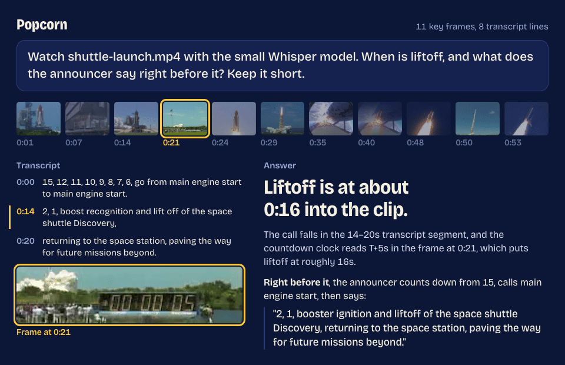

<h1 align="center">
  <br>
  🍿
  <br>
  popcorn
  <br>
</h1>

Popcorn を使うと、Claude Code などの MCP エージェントが手元のマシンにある動画ファイルを見られるようになります。



シーンが切り替わるところのキーフレームと、タイムスタンプ付きの文字起こしを返します。

**Claude Code にインストール**

```bash
claude mcp add popcorn -- npx -y claude-popcorn
```

**Claude Code のプラグインとしてもインストールできます。** この場合は `/popcorn:watch` スキルも追加されます。Claude Code の中で次を実行します。

```
/plugin marketplace add haithamelmengad/claude-popcorn
/plugin install popcorn@popcorn
```

**試してみる**

ふつうの言葉で頼み、動画のフルパスを伝えます。

- `Watch /path/to/talk.mp4 and tell me what it is about.`
- `In /path/to/talk.mp4, where do they talk about pricing? Give me the time.`
- `Give me the transcript of /path/to/talk.mp4 from 0:20 to 0:30.`

**対応クライアント**

| クライアント | セットアップ |
|--------|-------|
| Claude Code | 上のコマンドまたはプラグイン |
| Claude Desktop | `claude_desktop_config.json` にサーバーを追加します。[クイックスタート](#クイックスタート)を参照 |
| Codex | `codex mcp add popcorn -- npx -y claude-popcorn` |
| Cursor | 同じ `mcpServers` のエントリを `~/.cursor/mcp.json` に追加します |

**必要なもの**

- PATH の通った [FFmpeg](https://ffmpeg.org/)
- Node.js 20 以降
- 文字起こし用の Whisper バックエンドを 1 つ。なくてもフレームは取得できます。[文字起こしバックエンド](#文字起こしバックエンド)を参照

<p align="center">
  <a href="../../README.md">🇺🇸 English</a> •
  <a href="README.zh.md">🇨🇳 中文</a> •
  <a href="README.ja.md">🇯🇵 日本語</a> •
  <a href="README.ko.md">🇰🇷 한국어</a> •
  <a href="README.es.md">🇪🇸 Español</a> •
  <a href="README.de.md">🇩🇪 Deutsch</a> •
  <a href="README.fr.md">🇫🇷 Français</a> •
  <a href="README.pt.md">🇧🇷 Português</a> •
  <a href="README.ru.md">🇷🇺 Русский</a> •
  <a href="README.ar.md">🇸🇦 العربية</a> •
  <a href="README.it.md">🇮🇹 Italiano</a> •
  <a href="README.nl.md">🇳🇱 Nederlands</a> •
  <a href="README.tr.md">🇹🇷 Türkçe</a> •
  <a href="README.vi.md">🇻🇳 Tiếng Việt</a> •
  <a href="README.hi.md">🇮🇳 हिन्दी</a>
</p>

<p align="center">
  <a href="#クイックスタート">クイックスタート</a> •
  <a href="#仕組み">仕組み</a> •
  <a href="#mcp-ツール">MCP ツール</a> •
  <a href="#文字起こしバックエンド">文字起こし</a> •
  <a href="#設定">設定</a> •
  <a href="#トラブルシューティング">トラブルシューティング</a> •
  <a href="#ライセンス">ライセンス</a>
</p>

---

## クイックスタート

```bash
# Install FFmpeg (required)
brew install ffmpeg                    # macOS
sudo apt install ffmpeg                # Ubuntu/Debian

# Optional: Install a transcription backend
pip install mlx-whisper                # Apple Silicon (fastest)
pip install openai-whisper             # Any platform

# Add Popcorn to Claude Code
claude mcp add popcorn -- npx -y claude-popcorn
```

Claude Desktop の場合は、`~/Library/Application Support/Claude/claude_desktop_config.json` に次を追加します。

```json
{
  "mcpServers": {
    "popcorn": {
      "command": "npx",
      "args": ["-y", "claude-popcorn"]
    }
  }
}
```

**主な機能：**

- **シーン検出**：一定間隔ではなく、映像が切り替わるところでフレームを取得します
- **ローカルで文字起こし**：バックエンドは 4 種類（mlx-whisper、faster-whisper、whisper-cpp、whisper）
- **インライン画像**：キーフレームを MCP のレスポンスにそのまま入れて返します
- **スマートプリセット**：画面収録、プレゼンテーション、映画、インタビュー向けに自動で設定します
- **設定不要**：動画のパスを渡すだけで動きます
- **プライバシー優先**：すべてローカルで動き、データはマシンの外に出ません。Whisper のモデルは初回の利用時に一度だけダウンロードされます

---

## ドキュメント

### はじめに

- **[クイックスタート](#クイックスタート)**：インストールとセットアップ
- **[チュートリアル](../tutorial.md)**：手順を追った使い方ガイド
- **[MCP ツール](#mcp-ツール)**：使えるツールのリファレンス

### ガイド

- **[文字起こしバックエンド](#文字起こしバックエンド)**：自分の環境に合ったバックエンドを選ぶ
- **[動画の種類と目的](#動画の種類)**：コンテンツ別のプリセット
- **[設定](#設定)**：詳細なパラメータ

### リファレンス

- **[トラブルシューティング](../troubleshooting.md)**：よくある問題と解決方法
- **[エージェントスキル](../../skills/watch/SKILL.md)**：AI エージェント向けの手順
- **[API リファレンス](#mcp-ツール)**：ツールのスキーマとレスポンス

---

## 仕組み

**主なコンポーネント：**

1. **FFprobe**：動画のメタデータ（長さ、解像度、コーデック）を取り出します
2. **FFmpeg のシーン検出**：`select='gt(scene,N)'` フィルタで映像の切り替わりを見つけます
3. **フレームの並列抽出**：シーンが変わる時刻の JPEG を取得します
4. **複数バックエンドでの文字起こし**：Whisper の各実装が音声をタイムスタンプ付きのテキストに変換します
5. **分析バンドル**：結果を `.popcorn/` ディレクトリに保存します
6. **MCP レスポンス**：メタデータとインラインの base64 画像を返します

```
Video File ──▶ FFprobe ──▶ FFmpeg ──▶ Whisper ──▶ Analysis Bundle
                 │           │          │              │
                 ▼           ▼          ▼              ▼
              metadata    frames    transcript    MCP Response
```

---

## MCP ツール

| ツール | 説明 |
|------|-------------|
| `popcorn_analyze` | メインの分析。フレームを抽出し、音声を文字起こしして、結果を返します |
| `popcorn_suggest` | 動画のメタデータを調べ、おすすめの設定を返します |
| `popcorn_presets` | 使える動画の種類と目的を一覧表示します |
| `popcorn_backends` | システムを検出し、使える文字起こしの選択肢を表示します |
| `popcorn_read` | 時間で絞り込んで、文字起こしの一部を読みます |

### 基本的な使い方

```json
{
  "tool": "popcorn_analyze",
  "arguments": {
    "path": "/path/to/video.mp4"
  }
}
```

### プリセットを使う

```json
{
  "tool": "popcorn_analyze",
  "arguments": {
    "path": "/path/to/video.mp4",
    "videoType": "screencast",
    "objective": "detailed"
  }
}
```

---

## 動画の種類

| 種類 | 向いている内容 | シーン検出 |
|------|----------|-----------------|
| `screencast` | チュートリアル、コーディング、UI デモ | 低いしきい値 |
| `presentation` | スライド、講義、基調講演 | スライドの切り替わり |
| `movie` | 映画、テレビ番組 | バランス型 |
| `interview` | ポッドキャスト、トーク動画 | 文字起こし優先 |
| `surveillance` | 防犯カメラの映像、ドライブレコーダー | 高いしきい値 |
| `sports` | ライブイベント、動きの速い映像 | 高フレームレート |

## 目的

| 目的 | 使う場面 |
|-----------|----------|
| `summary` | ざっと概要を知りたい |
| `detailed` | 何も見落としたくない |
| `find_moment` | 特定の内容を探している |
| `transcribe` | 音声や発話がいちばん重要 |
| `visual_only` | 映像だけに関心がある |
| `quick_scan` | すばやくプレビューしたい |

---

## 文字起こしバックエンド

Popcorn はシステムを自動で検出し、最適なバックエンドをすすめます。

### バックエンドの比較

| バックエンド | 速度 | 向いている環境 | インストール |
|---------|-------|----------|---------|
| **mlx-whisper** | 最速 | Apple Silicon (M1/M2/M3/M4) | `pip install mlx-whisper` |
| **faster-whisper** | 高速 | NVIDIA GPU | `pip install faster-whisper` |
| **whisper-cpp** | 中程度 | クロスプラットフォーム | `brew install whisper-cpp` |
| **whisper** | 低速 | 互換性が最も高い | `pip install openai-whisper` |

whisper-cpp にはモデルファイルが必要です。[whisper.cpp](https://github.com/ggml-org/whisper.cpp/tree/master/models) から ggml モデルをダウンロードし、環境変数 `WHISPER_CPP_MODEL` にそのパスを設定するか、`model` にパスを渡してください。モデルファイルがない場合、Popcorn はこのバックエンドを利用不可と報告します。

### 処理時間（60 分の動画）

| バックエンド | 時間 |
|---------|------|
| mlx-whisper | 3-8 分 |
| faster-whisper | 5-10 分 |
| whisper-cpp | 10-20 分 |
| whisper | 30-60 分 |

### バックエンドを指定する

```json
{
  "tool": "popcorn_analyze",
  "arguments": {
    "path": "/path/to/video.mp4",
    "backend": "mlx-whisper"
  }
}
```

---

## 設定

### すべてのパラメータ

| パラメータ | 型 | 説明 |
|-----------|------|-------------|
| `path` | string | **必須。** 動画ファイルの絶対パス |
| `videoType` | string | 動画の種類のプリセット |
| `objective` | string | 分析の目的のプリセット |
| `transcribe` | boolean | 文字起こしを有効または無効にします |
| `backend` | string | 文字起こしバックエンド |
| `model` | string | Whisper のモデル（`tiny`、`base`、`small`、`medium`、`large`）。whisper-cpp の場合は ggml モデルファイルのパス |
| `language` | string | 言語コード（例：`en`、`es`、`fr`） |
| `frameMode` | string | `scene` または `interval` |
| `framesPerMin` | number | `interval` モードでの 1 分あたりのフレーム数 |
| `sceneThreshold` | number | シーン検出の感度（0-1） |
| `minSceneInterval` | number | シーンフレーム同士の最小間隔（秒） |
| `maxFrames` | number | 抽出するフレームの最大数 |
| `inlineFrames` | number | base64 で返すフレームの数 |
| `maxChunkChars` | number | 文字起こしのチャンクサイズ（文字数） |
| `maxTranscriptChars` | number | レスポンスに入れる文字起こし抜粋の長さ |
| `outDir` | string | 分析バンドルの出力ディレクトリ |

### 出力の構成

```
.popcorn/<video>_<timestamp>/
├── analysis.json          # Full metadata
├── transcript.txt         # Plain text
├── transcript.json        # Timestamped segments
├── transcript.chunks.json # LLM-friendly chunks
└── assets/
    ├── audio.wav
    └── frames/
        ├── scene_000001.jpg
        └── ...
```

---

## トラブルシューティング

### FFmpeg が見つからない

```bash
brew install ffmpeg          # macOS
sudo apt install ffmpeg      # Ubuntu/Debian
```

### 文字起こしバックエンドがない

```bash
pip install mlx-whisper      # Apple Silicon
pip install openai-whisper   # Any platform
```

### 検出されるフレームが少なすぎる

```json
{ "sceneThreshold": 0.15, "minSceneInterval": 2 }
```

### 検出されるフレームが多すぎる

```json
{ "sceneThreshold": 0.5, "minSceneInterval": 10 }
```

ほかの解決方法は **[トラブルシューティングガイド](../troubleshooting.md)** を参照してください。

---

## 開発

```bash
git clone https://github.com/haithamelmengad/claude-popcorn.git
cd claude-popcorn
npm install          # Install dependencies
npm run build        # Build
npm test             # Smoke test (needs ffmpeg)
npm run dev          # Development mode
npm start            # Run server
```

### プロジェクト構成

```
claude-popcorn/
├── src/
│   ├── index.ts        # MCP server
│   ├── analyze.ts      # Analysis pipeline
│   ├── ffmpeg.ts       # Video processing
│   ├── transcribe.ts   # Multi-backend transcription
│   ├── presets.ts      # Video type presets
│   ├── read.ts         # File and transcript reading
│   └── commands.ts     # Shell execution
├── docs/               # Documentation
└── skills/             # Agent skills
```

---

## コントリビュート

1. リポジトリをフォークします
2. フィーチャーブランチを作成します（`git checkout -b feature/amazing`）
3. 変更をコミットします（`git commit -m 'Add amazing feature'`）
4. ブランチにプッシュします（`git push origin feature/amazing`）
5. Pull Request を作成します

---

## ライセンス

MIT ライセンス。詳しくは [LICENSE](../../LICENSE) を参照してください。

---

## 謝辞

- [OpenAI Whisper](https://github.com/openai/whisper)：音声認識
- [whisper.cpp](https://github.com/ggerganov/whisper.cpp)：C++ 移植版
- [MLX Whisper](https://github.com/ml-explore/mlx-examples)：Apple Silicon
- [faster-whisper](https://github.com/guillaumekln/faster-whisper)：CTranslate2
- [FFmpeg](https://ffmpeg.org/)：動画処理
- [Model Context Protocol](https://modelcontextprotocol.io/)：MCP 仕様

---

Popcorn は独立したプロジェクトです。Anthropic と提携しておらず、Anthropic の承認も受けていません。

<p align="center">
  世界中の AI エージェントのために 🍿 を込めて作りました
</p>
