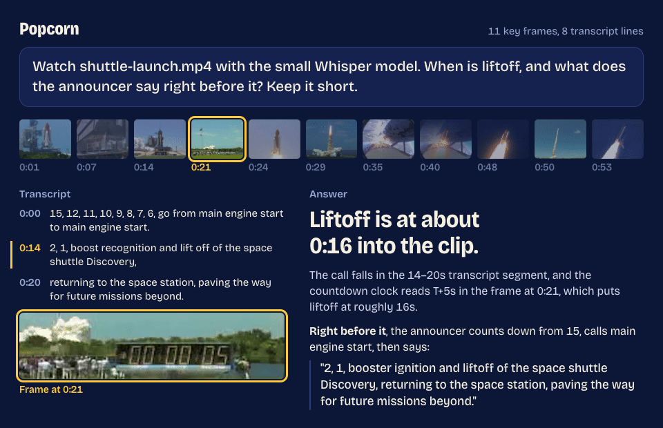

<h1 align="center">
  <br>
  🍿
  <br>
  popcorn
  <br>
</h1>

Met Popcorn kunnen Claude Code en andere MCP-agents een videobestand op je computer bekijken.



Je krijgt keyframes van de scènewissels en een transcript met tijdcodes.

**Installeren voor Claude Code**

```bash
claude mcp add popcorn -- npx -y claude-popcorn
```

**Of installeer het als plug-in voor Claude Code.** Dan krijg je ook de skill `/popcorn:watch`. Voer deze opdrachten uit in Claude Code:

```
/plugin marketplace add haithamelmengad/claude-popcorn
/plugin install popcorn@popcorn
```

**Probeer het uit**

Vraag het in gewone woorden en geef het volledige pad naar de video:

- `Watch /path/to/talk.mp4 and tell me what it is about.`
- `In /path/to/talk.mp4, where do they talk about pricing? Give me the time.`
- `Give me the transcript of /path/to/talk.mp4 from 0:20 to 0:30.`

**Werkt met**

| Client | Installatie |
|--------|-------------|
| Claude Code | De opdracht of de plug-in hierboven |
| Claude Desktop | Voeg de server toe aan `claude_desktop_config.json`. Zie [Snel aan de slag](#snel-aan-de-slag) |
| Codex | `codex mcp add popcorn -- npx -y claude-popcorn` |
| Cursor | Voeg dezelfde `mcpServers`-vermelding toe aan `~/.cursor/mcp.json` |

**Vereisten**

- [FFmpeg](https://ffmpeg.org/) in je PATH
- Node.js 20 of nieuwer
- Eén Whisper-backend voor transcripten. Zonder backend krijg je nog steeds de frames. Zie [Transcriptie-backends](#transcriptie-backends)

<p align="center">
  <a href="../../README.md">🇺🇸 English</a> •
  <a href="README.zh.md">🇨🇳 中文</a> •
  <a href="README.ja.md">🇯🇵 日本語</a> •
  <a href="README.ko.md">🇰🇷 한국어</a> •
  <a href="README.es.md">🇪🇸 Español</a> •
  <a href="README.de.md">🇩🇪 Deutsch</a> •
  <a href="README.fr.md">🇫🇷 Français</a> •
  <a href="README.pt.md">🇧🇷 Português</a> •
  <a href="README.ru.md">🇷🇺 Русский</a> •
  <a href="README.ar.md">🇸🇦 العربية</a> •
  <a href="README.it.md">🇮🇹 Italiano</a> •
  <a href="README.nl.md">🇳🇱 Nederlands</a> •
  <a href="README.tr.md">🇹🇷 Türkçe</a> •
  <a href="README.vi.md">🇻🇳 Tiếng Việt</a> •
  <a href="README.hi.md">🇮🇳 हिन्दी</a>
</p>

<p align="center">
  <a href="#snel-aan-de-slag">Snel aan de slag</a> •
  <a href="#hoe-het-werkt">Hoe het werkt</a> •
  <a href="#mcp-tools">MCP-tools</a> •
  <a href="#transcriptie-backends">Transcriptie</a> •
  <a href="#configuratie">Configuratie</a> •
  <a href="#problemen-oplossen">Problemen oplossen</a> •
  <a href="#licentie">Licentie</a>
</p>

---

## Snel aan de slag

```bash
# Install FFmpeg (required)
brew install ffmpeg                    # macOS
sudo apt install ffmpeg                # Ubuntu/Debian

# Optional: Install a transcription backend
pip install mlx-whisper                # Apple Silicon (fastest)
pip install openai-whisper             # Any platform

# Add Popcorn to Claude Code
claude mcp add popcorn -- npx -y claude-popcorn
```

Voor Claude Desktop voeg je dit toe aan `~/Library/Application Support/Claude/claude_desktop_config.json`:

```json
{
  "mcpServers": {
    "popcorn": {
      "command": "npx",
      "args": ["-y", "claude-popcorn"]
    }
  }
}
```

**Belangrijkste functies:**

- **Scènedetectie**: legt frames vast bij visuele overgangen, niet met vaste tussenpozen
- **Lokale transcriptie**: 4 backends om uit te kiezen (mlx-whisper, faster-whisper, whisper-cpp, whisper)
- **Inline afbeeldingen**: stuurt keyframes direct mee in MCP-antwoorden
- **Slimme presets**: stelt zichzelf in voor screencasts, presentaties, films en interviews
- **Geen configuratie**: geef een videopad op en het werkt
- **Privacy voorop**: alles draait lokaal, er verlaten geen gegevens je computer. Whisper-modellen worden één keer gedownload, bij het eerste gebruik

---

## Documentatie

### Aan de slag

- **[Snel aan de slag](#snel-aan-de-slag)**: installatie en configuratie
- **[Tutorial](../tutorial.md)**: stapsgewijze gebruiksgids
- **[MCP-tools](#mcp-tools)**: overzicht van de beschikbare tools

### Handleidingen

- **[Transcriptie-backends](#transcriptie-backends)**: kies de beste backend voor je systeem
- **[Videotypen en doelen](#videotypen)**: presets voor verschillende soorten content
- **[Configuratie](#configuratie)**: geavanceerde parameters

### Naslag

- **[Problemen oplossen](../troubleshooting.md)**: veelvoorkomende problemen en oplossingen
- **[Agent-skill](../../skills/watch/SKILL.md)**: instructies voor AI-agents
- **[API-referentie](#mcp-tools)**: toolschema's en antwoorden

---

## Hoe het werkt

**Kernonderdelen:**

1. **FFprobe**: leest de metadata van de video uit (duur, resolutie, codecs)
2. **Scènedetectie met FFmpeg**: vindt visuele overgangen met het filter `select='gt(scene,N)'`
3. **Parallelle frame-extractie**: slaat JPEG's op bij de tijdstippen van de scènewissels
4. **Transcriptie met meerdere backends**: Whisper-varianten zetten audio om in tekst met tijdcodes
5. **Analysebundel**: de resultaten worden opgeslagen in de map `.popcorn/`
6. **MCP-antwoord**: geeft metadata en inline base64-afbeeldingen terug

```
Video File ──▶ FFprobe ──▶ FFmpeg ──▶ Whisper ──▶ Analysis Bundle
                 │           │          │              │
                 ▼           ▼          ▼              ▼
              metadata    frames    transcript    MCP Response
```

---

## MCP-tools

| Tool | Beschrijving |
|------|--------------|
| `popcorn_analyze` | Hoofdanalyse: haalt frames op, transcribeert audio en geeft de resultaten terug |
| `popcorn_suggest` | Leest de metadata van de video en geeft aanbevolen instellingen |
| `popcorn_presets` | Toont de beschikbare videotypen en doelen |
| `popcorn_backends` | Detecteert je systeem en toont de transcriptieopties |
| `popcorn_read` | Leest delen van het transcript, gefilterd op tijd |

### Basisgebruik

```json
{
  "tool": "popcorn_analyze",
  "arguments": {
    "path": "/path/to/video.mp4"
  }
}
```

### Met presets

```json
{
  "tool": "popcorn_analyze",
  "arguments": {
    "path": "/path/to/video.mp4",
    "videoType": "screencast",
    "objective": "detailed"
  }
}
```

---

## Videotypen

| Type | Geschikt voor | Scènedetectie |
|------|---------------|---------------|
| `screencast` | Tutorials, programmeersessies, UI-demo's | Lage drempel |
| `presentation` | Dia's, colleges, keynotes | Diawissels |
| `movie` | Films, tv-series | Gebalanceerd |
| `interview` | Podcasts, talking heads | Transcriptie eerst |
| `surveillance` | Beveiligingsbeelden, dashcam | Hoge drempel |
| `sports` | Live-evenementen, snelle actie | Hoge framesnelheid |

## Doelen

| Doel | Gebruik wanneer |
|------|-----------------|
| `summary` | Je snel een overzicht wilt |
| `detailed` | Je niets wilt missen |
| `find_moment` | Je een specifiek fragment zoekt |
| `transcribe` | Audio en spraak het belangrijkst zijn |
| `visual_only` | Alleen het beeld telt |
| `quick_scan` | Je een snelle preview wilt |

---

## Transcriptie-backends

Popcorn detecteert je systeem automatisch en raadt de beste backend aan.

### Backends vergeleken

| Backend | Snelheid | Geschikt voor | Installatie |
|---------|----------|---------------|-------------|
| **mlx-whisper** | Snelst | Apple Silicon (M1/M2/M3/M4) | `pip install mlx-whisper` |
| **faster-whisper** | Snel | NVIDIA-GPU's | `pip install faster-whisper` |
| **whisper-cpp** | Gemiddeld | Alle platforms | `brew install whisper-cpp` |
| **whisper** | Traag | Breedste compatibiliteit | `pip install openai-whisper` |

whisper-cpp heeft een modelbestand nodig. Download een ggml-model van [whisper.cpp](https://github.com/ggml-org/whisper.cpp/tree/master/models) en zet het pad in de omgevingsvariabele `WHISPER_CPP_MODEL`, of geef het pad mee als `model`. Zonder modelbestand meldt Popcorn dat deze backend niet beschikbaar is.

### Verwerkingstijden (video van 60 minuten)

| Backend | Tijd |
|---------|------|
| mlx-whisper | 3-8 min |
| faster-whisper | 5-10 min |
| whisper-cpp | 10-20 min |
| whisper | 30-60 min |

### Een backend afdwingen

```json
{
  "tool": "popcorn_analyze",
  "arguments": {
    "path": "/path/to/video.mp4",
    "backend": "mlx-whisper"
  }
}
```

---

## Configuratie

### Alle parameters

| Parameter | Type | Beschrijving |
|-----------|------|--------------|
| `path` | string | **Verplicht.** Absoluut pad naar het videobestand |
| `videoType` | string | Preset voor het videotype |
| `objective` | string | Preset voor het analysedoel |
| `transcribe` | boolean | Transcriptie in- of uitschakelen |
| `backend` | string | Transcriptie-backend |
| `model` | string | Whisper-model (`tiny`, `base`, `small`, `medium`, `large`). Voor whisper-cpp: pad naar een ggml-modelbestand |
| `language` | string | Taalcode (bijv. `en`, `es`, `fr`) |
| `frameMode` | string | `scene` of `interval` |
| `framesPerMin` | number | Frames per minuut in de modus `interval` |
| `sceneThreshold` | number | Scènegevoeligheid (0-1) |
| `minSceneInterval` | number | Minimaal aantal seconden tussen scèneframes |
| `maxFrames` | number | Maximaal aantal frames dat wordt opgehaald |
| `inlineFrames` | number | Aantal frames dat als base64 wordt teruggegeven |
| `maxChunkChars` | number | Grootte van een transcriptdeel in tekens |
| `maxTranscriptChars` | number | Lengte van het transcriptfragment in het antwoord |
| `outDir` | string | Uitvoermap voor de analysebundel |

### Uitvoerstructuur

```
.popcorn/<video>_<timestamp>/
├── analysis.json          # Full metadata
├── transcript.txt         # Plain text
├── transcript.json        # Timestamped segments
├── transcript.chunks.json # LLM-friendly chunks
└── assets/
    ├── audio.wav
    └── frames/
        ├── scene_000001.jpg
        └── ...
```

---

## Problemen oplossen

### FFmpeg niet gevonden

```bash
brew install ffmpeg          # macOS
sudo apt install ffmpeg      # Ubuntu/Debian
```

### Geen transcriptie-backend

```bash
pip install mlx-whisper      # Apple Silicon
pip install openai-whisper   # Any platform
```

### Te weinig frames gedetecteerd

```json
{ "sceneThreshold": 0.15, "minSceneInterval": 2 }
```

### Te veel frames gedetecteerd

```json
{ "sceneThreshold": 0.5, "minSceneInterval": 10 }
```

Zie de **[gids voor probleemoplossing](../troubleshooting.md)** voor meer oplossingen.

---

## Ontwikkeling

```bash
git clone https://github.com/haithamelmengad/claude-popcorn.git
cd claude-popcorn
npm install          # Install dependencies
npm run build        # Build
npm test             # Smoke test (needs ffmpeg)
npm run dev          # Development mode
npm start            # Run server
```

### Projectstructuur

```
claude-popcorn/
├── src/
│   ├── index.ts        # MCP server
│   ├── analyze.ts      # Analysis pipeline
│   ├── ffmpeg.ts       # Video processing
│   ├── transcribe.ts   # Multi-backend transcription
│   ├── presets.ts      # Video type presets
│   ├── read.ts         # File and transcript reading
│   └── commands.ts     # Shell execution
├── docs/               # Documentation
└── skills/             # Agent skills
```

---

## Bijdragen

1. Fork de repository
2. Maak een featurebranch (`git checkout -b feature/amazing`)
3. Commit je wijzigingen (`git commit -m 'Add amazing feature'`)
4. Push de branch (`git push origin feature/amazing`)
5. Open een pull request

---

## Licentie

MIT-licentie. Zie [LICENSE](../../LICENSE) voor de details.

---

## Dankwoord

- [OpenAI Whisper](https://github.com/openai/whisper): spraakherkenning
- [whisper.cpp](https://github.com/ggerganov/whisper.cpp): C++-port
- [MLX Whisper](https://github.com/ml-explore/mlx-examples): Apple Silicon
- [faster-whisper](https://github.com/guillaumekln/faster-whisper): CTranslate2
- [FFmpeg](https://ffmpeg.org/): videoverwerking
- [Model Context Protocol](https://modelcontextprotocol.io/): MCP-specificatie

---

Popcorn is een onafhankelijk project. Het is niet verbonden aan Anthropic en wordt niet door Anthropic onderschreven.

<p align="center">
  Gemaakt met 🍿 voor AI-agents overal
</p>
