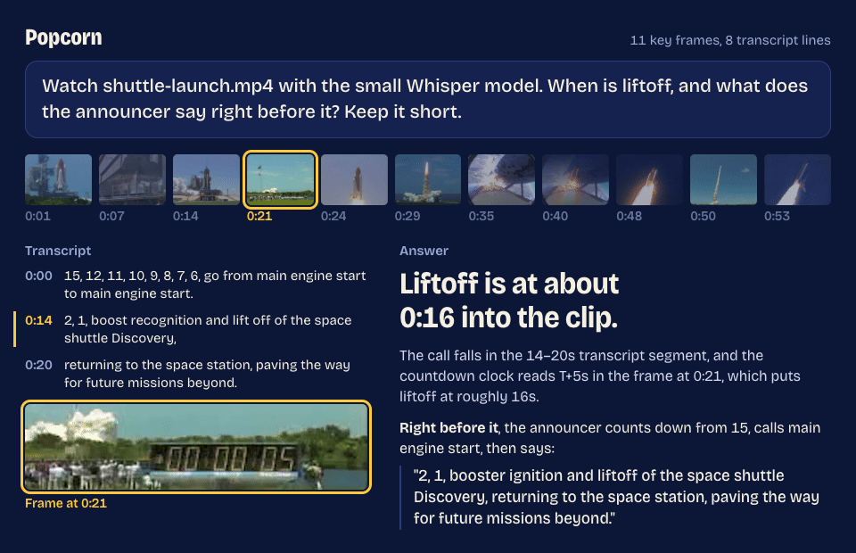

<h1 align="center">
  <br>
  🍿
  <br>
  popcorn
  <br>
</h1>

Popcorn, Claude Code ve diğer MCP ajanlarının bilgisayarınızdaki bir video dosyasını izlemesini sağlar.



Sahne değişimlerinden anahtar kareler ve zaman damgalı bir transkript döndürür.

**Claude Code için kurulum**

```bash
claude mcp add popcorn -- npx -y claude-popcorn
```

**Ya da Claude Code eklentisi olarak kurun.** Bu yöntem `/popcorn:watch` becerisini de ekler. Şu komutları Claude Code içinde çalıştırın:

```
/plugin marketplace add haithamelmengad/claude-popcorn
/plugin install popcorn@popcorn
```

**Deneyin**

Sade bir dille sorun ve videonun tam yolunu verin:

- `Watch /path/to/talk.mp4 and tell me what it is about.`
- `In /path/to/talk.mp4, where do they talk about pricing? Give me the time.`
- `Give me the transcript of /path/to/talk.mp4 from 0:20 to 0:30.`

**Şunlarla çalışır**

| İstemci | Kurulum |
|---------|---------|
| Claude Code | Yukarıdaki komut veya eklenti |
| Claude Desktop | Sunucuyu `claude_desktop_config.json` dosyasına ekleyin. Bkz. [Hızlı Başlangıç](#hızlı-başlangıç) |
| Codex | `codex mcp add popcorn -- npx -y claude-popcorn` |
| Cursor | Aynı `mcpServers` girdisini `~/.cursor/mcp.json` dosyasına ekleyin |

**Gereksinimler**

- PATH üzerinde [FFmpeg](https://ffmpeg.org/)
- Node.js 20 veya üzeri
- Transkript için bir Whisper arka ucu. Arka uç olmadan da kareleri alırsınız. Bkz. [Transkripsiyon Arka Uçları](#transkripsiyon-arka-uçları)

<p align="center">
  <a href="../../README.md">🇺🇸 English</a> •
  <a href="README.zh.md">🇨🇳 中文</a> •
  <a href="README.ja.md">🇯🇵 日本語</a> •
  <a href="README.ko.md">🇰🇷 한국어</a> •
  <a href="README.es.md">🇪🇸 Español</a> •
  <a href="README.de.md">🇩🇪 Deutsch</a> •
  <a href="README.fr.md">🇫🇷 Français</a> •
  <a href="README.pt.md">🇧🇷 Português</a> •
  <a href="README.ru.md">🇷🇺 Русский</a> •
  <a href="README.ar.md">🇸🇦 العربية</a> •
  <a href="README.it.md">🇮🇹 Italiano</a> •
  <a href="README.nl.md">🇳🇱 Nederlands</a> •
  <a href="README.tr.md">🇹🇷 Türkçe</a> •
  <a href="README.vi.md">🇻🇳 Tiếng Việt</a> •
  <a href="README.hi.md">🇮🇳 हिन्दी</a>
</p>

<p align="center">
  <a href="#hızlı-başlangıç">Hızlı Başlangıç</a> •
  <a href="#nasıl-çalışır">Nasıl Çalışır</a> •
  <a href="#mcp-araçları">MCP Araçları</a> •
  <a href="#transkripsiyon-arka-uçları">Transkripsiyon</a> •
  <a href="#yapılandırma">Yapılandırma</a> •
  <a href="#sorun-giderme">Sorun Giderme</a> •
  <a href="#lisans">Lisans</a>
</p>

---

## Hızlı Başlangıç

```bash
# Install FFmpeg (required)
brew install ffmpeg                    # macOS
sudo apt install ffmpeg                # Ubuntu/Debian

# Optional: Install a transcription backend
pip install mlx-whisper                # Apple Silicon (fastest)
pip install openai-whisper             # Any platform

# Add Popcorn to Claude Code
claude mcp add popcorn -- npx -y claude-popcorn
```

Claude Desktop için şunu `~/Library/Application Support/Claude/claude_desktop_config.json` dosyasına ekleyin:

```json
{
  "mcpServers": {
    "popcorn": {
      "command": "npx",
      "args": ["-y", "claude-popcorn"]
    }
  }
}
```

**Öne Çıkan Özellikler:**

- **Sahne Algılama**: Kareleri sabit aralıklarla değil, görsel geçişlerde yakalar
- **Yerel Transkripsiyon**: 4 arka uç seçeneği (mlx-whisper, faster-whisper, whisper-cpp, whisper)
- **Satır İçi Görseller**: Anahtar kareleri doğrudan MCP yanıtlarında döndürür
- **Akıllı Ön Ayarlar**: Ekran kayıtları, sunumlar, filmler ve röportajlar için kendini ayarlar
- **Sıfır Yapılandırma**: Bir video yolu verin, çalışır
- **Önce Gizlilik**: Her şey yerelde çalışır, bilgisayarınızdan hiçbir veri çıkmaz. Whisper modelleri bir kez, ilk kullanımda indirilir

---

## Belgeler

### Başlarken

- **[Hızlı Başlangıç](#hızlı-başlangıç)**: Kurulum ve ayarlar
- **[Öğretici](../tutorial.md)**: Adım adım kullanım kılavuzu
- **[MCP Araçları](#mcp-araçları)**: Kullanılabilir araçların başvurusu

### Kılavuzlar

- **[Transkripsiyon Arka Uçları](#transkripsiyon-arka-uçları)**: Sisteminize en uygun arka ucu seçin
- **[Video Türleri ve Hedefler](#video-türleri)**: Farklı içerikler için ön ayarlar
- **[Yapılandırma](#yapılandırma)**: Gelişmiş parametreler

### Başvuru

- **[Sorun Giderme](../troubleshooting.md)**: Sık görülen sorunlar ve çözümleri
- **[Ajan Becerisi](../../skills/watch/SKILL.md)**: Yapay zeka ajanları için talimatlar
- **[API Başvurusu](#mcp-araçları)**: Araç şemaları ve yanıtlar

---

## Nasıl Çalışır

**Temel Bileşenler:**

1. **FFprobe**: Video meta verilerini çıkarır (süre, çözünürlük, kodekler)
2. **FFmpeg ile Sahne Algılama**: Görsel geçişleri `select='gt(scene,N)'` filtresiyle bulur
3. **Paralel Kare Çıkarma**: Sahne değişimi anlarında JPEG kareleri kaydeder
4. **Çok Arka Uçlu Transkripsiyon**: Whisper türevleri sesi zaman damgalı metne çevirir
5. **Analiz Paketi**: Sonuçlar `.popcorn/` dizinine kaydedilir
6. **MCP Yanıtı**: Meta verileri ve satır içi base64 görselleri döndürür

```
Video File ──▶ FFprobe ──▶ FFmpeg ──▶ Whisper ──▶ Analysis Bundle
                 │           │          │              │
                 ▼           ▼          ▼              ▼
              metadata    frames    transcript    MCP Response
```

---

## MCP Araçları

| Araç | Açıklama |
|------|----------|
| `popcorn_analyze` | Ana analiz: kareleri çıkarır, sesi yazıya döker, sonuçları döndürür |
| `popcorn_suggest` | Video meta verilerini okur ve önerilen ayarları verir |
| `popcorn_presets` | Kullanılabilir video türlerini ve hedefleri listeler |
| `popcorn_backends` | Sisteminizi algılar ve transkripsiyon seçeneklerini gösterir |
| `popcorn_read` | Transkriptin bölümlerini zamana göre filtreleyerek okur |

### Temel Kullanım

```json
{
  "tool": "popcorn_analyze",
  "arguments": {
    "path": "/path/to/video.mp4"
  }
}
```

### Ön Ayarlarla

```json
{
  "tool": "popcorn_analyze",
  "arguments": {
    "path": "/path/to/video.mp4",
    "videoType": "screencast",
    "objective": "detailed"
  }
}
```

---

## Video Türleri

| Tür | Uygun Olduğu İçerik | Sahne Algılama |
|-----|---------------------|----------------|
| `screencast` | Eğitim videoları, kodlama oturumları, arayüz demoları | Düşük eşik |
| `presentation` | Slaytlar, dersler, açılış konuşmaları | Slayt geçişleri |
| `movie` | Filmler, diziler | Dengeli |
| `interview` | Podcast'ler, kameraya konuşulan videolar | Transkripsiyon önceliği |
| `surveillance` | Güvenlik kamerası görüntüleri, araç kamerası | Yüksek eşik |
| `sports` | Canlı etkinlikler, hızlı aksiyon | Yüksek kare hızı |

## Hedefler

| Hedef | Ne Zaman Kullanılır |
|-------|---------------------|
| `summary` | Hızlı bir genel bakış gerektiğinde |
| `detailed` | Hiçbir şeyi kaçırmak istemediğinizde |
| `find_moment` | Belirli bir içeriği ararken |
| `transcribe` | En önemli şey ses ve konuşma olduğunda |
| `visual_only` | Yalnızca görüntü önemli olduğunda |
| `quick_scan` | Hızlı bir ön izleme gerektiğinde |

---

## Transkripsiyon Arka Uçları

Popcorn sisteminizi kendiliğinden algılar ve en iyi arka ucu önerir.

### Arka Uç Karşılaştırması

| Arka Uç | Hız | Uygun Olduğu Ortam | Kurulum |
|---------|-----|--------------------|---------|
| **mlx-whisper** | En hızlı | Apple Silicon (M1/M2/M3/M4) | `pip install mlx-whisper` |
| **faster-whisper** | Hızlı | NVIDIA GPU'lar | `pip install faster-whisper` |
| **whisper-cpp** | Orta | Tüm platformlar | `brew install whisper-cpp` |
| **whisper** | Yavaş | En geniş uyumluluk | `pip install openai-whisper` |

whisper-cpp bir model dosyası ister. [whisper.cpp](https://github.com/ggml-org/whisper.cpp/tree/master/models) deposundan bir ggml modeli indirin ve yolunu `WHISPER_CPP_MODEL` ortam değişkenine yazın ya da yolu `model` parametresiyle verin. Model dosyası yoksa Popcorn bu arka ucu kullanılamaz olarak bildirir.

### İşlem Süreleri (60 dakikalık video)

| Arka Uç | Süre |
|---------|------|
| mlx-whisper | 3-8 dk |
| faster-whisper | 5-10 dk |
| whisper-cpp | 10-20 dk |
| whisper | 30-60 dk |

### Belirli Bir Arka Ucu Zorunlu Kılma

```json
{
  "tool": "popcorn_analyze",
  "arguments": {
    "path": "/path/to/video.mp4",
    "backend": "mlx-whisper"
  }
}
```

---

## Yapılandırma

### Tüm Parametreler

| Parametre | Tür | Açıklama |
|-----------|-----|----------|
| `path` | string | **Zorunlu.** Video dosyasının mutlak yolu |
| `videoType` | string | Video türü ön ayarı |
| `objective` | string | Analiz hedefi ön ayarı |
| `transcribe` | boolean | Transkripsiyonu açar veya kapatır |
| `backend` | string | Transkripsiyon arka ucu |
| `model` | string | Whisper modeli (`tiny`, `base`, `small`, `medium`, `large`). whisper-cpp için: bir ggml model dosyasının yolu |
| `language` | string | Dil kodu (ör. `en`, `es`, `fr`) |
| `frameMode` | string | `scene` veya `interval` |
| `framesPerMin` | number | `interval` modunda dakika başına kare sayısı |
| `sceneThreshold` | number | Sahne hassasiyeti (0-1) |
| `minSceneInterval` | number | Sahne kareleri arasındaki en az saniye |
| `maxFrames` | number | Çıkarılacak en fazla kare sayısı |
| `inlineFrames` | number | base64 olarak döndürülecek kare sayısı |
| `maxChunkChars` | number | Transkript parçasının karakter cinsinden boyutu |
| `maxTranscriptChars` | number | Yanıttaki transkript alıntısının uzunluğu |
| `outDir` | string | Analiz paketinin çıktı dizini |

### Çıktı Yapısı

```
.popcorn/<video>_<timestamp>/
├── analysis.json          # Full metadata
├── transcript.txt         # Plain text
├── transcript.json        # Timestamped segments
├── transcript.chunks.json # LLM-friendly chunks
└── assets/
    ├── audio.wav
    └── frames/
        ├── scene_000001.jpg
        └── ...
```

---

## Sorun Giderme

### FFmpeg bulunamadı

```bash
brew install ffmpeg          # macOS
sudo apt install ffmpeg      # Ubuntu/Debian
```

### Transkripsiyon arka ucu yok

```bash
pip install mlx-whisper      # Apple Silicon
pip install openai-whisper   # Any platform
```

### Çok az kare algılandı

```json
{ "sceneThreshold": 0.15, "minSceneInterval": 2 }
```

### Çok fazla kare algılandı

```json
{ "sceneThreshold": 0.5, "minSceneInterval": 10 }
```

Daha fazla çözüm için **[Sorun Giderme Kılavuzu](../troubleshooting.md)** sayfasına bakın.

---

## Geliştirme

```bash
git clone https://github.com/haithamelmengad/claude-popcorn.git
cd claude-popcorn
npm install          # Install dependencies
npm run build        # Build
npm test             # Smoke test (needs ffmpeg)
npm run dev          # Development mode
npm start            # Run server
```

### Proje Yapısı

```
claude-popcorn/
├── src/
│   ├── index.ts        # MCP server
│   ├── analyze.ts      # Analysis pipeline
│   ├── ffmpeg.ts       # Video processing
│   ├── transcribe.ts   # Multi-backend transcription
│   ├── presets.ts      # Video type presets
│   ├── read.ts         # File and transcript reading
│   └── commands.ts     # Shell execution
├── docs/               # Documentation
└── skills/             # Agent skills
```

---

## Katkıda Bulunma

1. Depoyu fork edin
2. Bir özellik dalı oluşturun (`git checkout -b feature/amazing`)
3. Değişikliklerinizi commit edin (`git commit -m 'Add amazing feature'`)
4. Dalı gönderin (`git push origin feature/amazing`)
5. Bir Pull Request açın

---

## Lisans

MIT Lisansı. Ayrıntılar için [LICENSE](../../LICENSE) dosyasına bakın.

---

## Teşekkürler

- [OpenAI Whisper](https://github.com/openai/whisper): Konuşma tanıma
- [whisper.cpp](https://github.com/ggerganov/whisper.cpp): C++ uyarlaması
- [MLX Whisper](https://github.com/ml-explore/mlx-examples): Apple Silicon
- [faster-whisper](https://github.com/guillaumekln/faster-whisper): CTranslate2
- [FFmpeg](https://ffmpeg.org/): Video işleme
- [Model Context Protocol](https://modelcontextprotocol.io/): MCP belirtimi

---

Popcorn bağımsız bir projedir. Anthropic ile bağlantılı değildir ve Anthropic tarafından onaylanmamıştır.

<p align="center">
  Her yerdeki yapay zeka ajanları için 🍿 ile yapıldı
</p>
